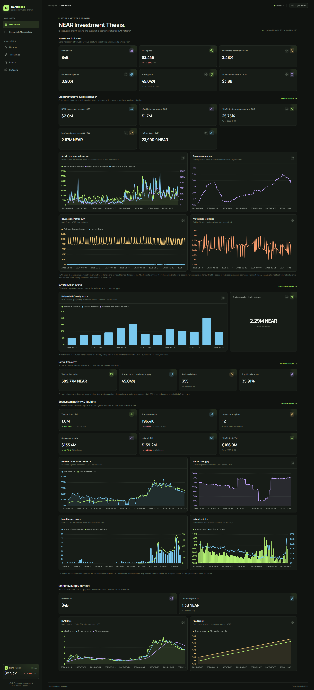
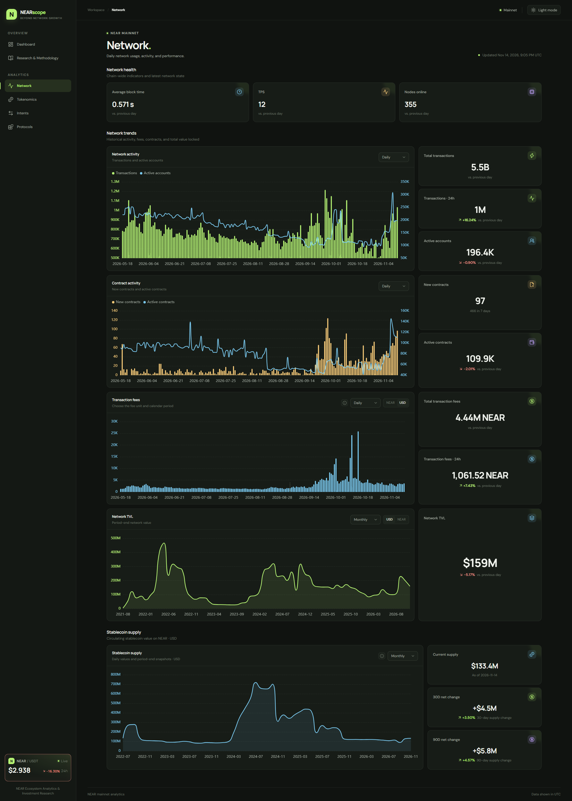
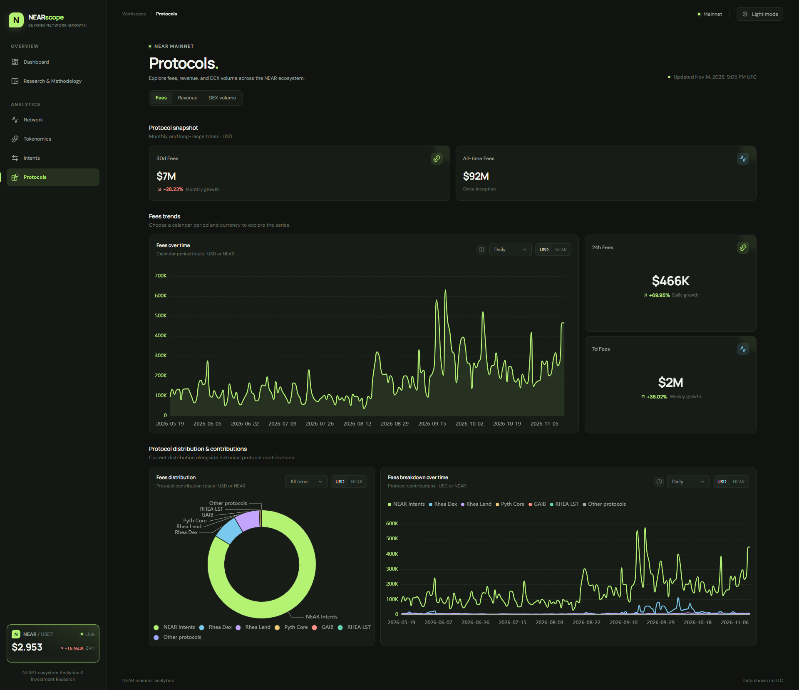

# NEARProtocol: Beyond Network Growth

"Beyond Network Growth" is a data pipeline and dashboard for looking past transaction counts. It asks whether activity across NEAR is matched by fees and revenue, whether any of that value is captured in ways relevant to the token, and how issuance, burns, and staking fit into the picture.

The dashboard brings those measures together; it does not treat any one of them as proof of investment merit. Reported revenue, transfers to a wallet, completed purchases, and token burns are different things, and the project keeps them separate.

## Screenshots

<p align="center">
  
  
</p>
<p align="center">
  
  
</p>

**[Open the live demo](https://scintillating-yeot-b124e3.netlify.app/)**

These captures show the app with the local data available when they were taken. Values on the live site may have moved on.

## What the project covers

The analysis is organized around four parts of the same question:

- **Network:** usage, accounts, transactions, contracts, fees, and liquidity.
- **Protocols:** app-level fees, reported revenue, and DEX volume.
- **NEAR Intents:** cross-chain volume and TVL, reported fees and revenue, holder allocation, and related transfers to the buyback wallet.
- **Tokenomics and staking:** supply growth, fee burns, issuance estimates, active stake, and validator concentration.

The pipeline has four stages:

```text
provider → raw → normalized → analytics → dashboard
```

Collectors save provider responses in `data/raw/`. Normalizers validate and standardize those records in `data/normalized/`. Analytics joins sources, applies formulas, and writes chart-ready files to `data/analytics/`. The Nuxt app reads and formats those outputs; it does not calculate tokenomics or roll up daily observations.

Generated JSON under `data/` and the dashboard's `public/data/` copy are local and ignored by Git. A fresh clone will not contain the project's collected results. Run the pipeline before expecting the dashboard to show populated charts.

## Collect and prepare data

Python 3.11 or newer is required. Install dependencies from the repository root.

**Windows PowerShell**

```powershell
py -m venv .venv
.\.venv\Scripts\Activate.ps1
py -m pip install -r requirements.txt
```

**macOS or Linux**

```bash
python3 -m venv .venv
source .venv/bin/activate
python -m pip install -r requirements.txt
```

The collectors use the official `google-cloud-bigquery` client and the `near-jsonrpc-client` package. BigQuery is Google's hosted service; there is no BigQuery server to install locally. The Google Cloud CLI is needed to set up credentials for BigQuery collection.

### BigQuery credentials and billing

The SQL reads Google's public NEAR mainnet tables, but running a query job uses your Google Cloud project. Install the [Google Cloud CLI](https://cloud.google.com/sdk/docs/install), initialize it, and create Application Default Credentials:

```shell
gcloud init
gcloud auth application-default login
```

Enable the BigQuery API on the project. If the client cannot infer the project from your credentials, set `GOOGLE_CLOUD_PROJECT` before running the pipeline:

```powershell
$env:GOOGLE_CLOUD_PROJECT = "your-google-cloud-project"
```

```bash
export GOOGLE_CLOUD_PROJECT="your-google-cloud-project"
```

BigQuery usage can incur charges. Several collectors set a maximum-bytes-billed limit per query; a query above that limit fails. The limit is a guard, not a guarantee that all work below it is free. Check your project's billing settings and Google's [BigQuery pricing](https://cloud.google.com/bigquery/pricing) before running or changing expensive queries.

### NearBlocks key

The NearBlocks collectors can make requests without a key at a conservative rate. If you need the higher request limits available under your plan, create a key in NearBlocks and put it in the repository-root `.env` file:

```dotenv
NEARBLOCKS_API_KEY=your-key-here
```

The client sends the key as a Bearer token. Limits depend on the current plan; see the [NearBlocks API docs](https://api.nearblocks.io/api-docs/). `.env` is ignored by Git. Do not put this key in a `NUXT_PUBLIC_*` variable or commit it.

### Run the full pipeline

From the repository root:

```powershell
py scripts/main.py
```

On macOS or Linux:

```bash
python3 scripts/main.py
```

This runs Fetch, Normalize, and Analytics in order. If a source fails, the pipeline reports it and continues with the other sections where possible. Failed requests can be retried on the next run. Successful requests use a cooldown, so an ordinary rerun does not call every provider again. `data/raw/request_state.json` records request times and outcomes. Daily collectors resume from their latest saved dates and request completed UTC days.

Historical active validator stake runs at the end of Fetch because it reads block heights from the raw BigQuery `daily_supply.json`. On an empty checkpoint, it starts three calendar months before the current UTC date. After that it resumes after the latest saved date and preserves successful daily results if a later RPC call fails. The initial collection can take several minutes.

To rebuild the local files without fetching new provider data:

```powershell
py scripts/normalize.py
py scripts/build_analytics.py
```

Use `python3` instead of `py` on macOS or Linux. `build_analytics.py` syncs its outputs to the dashboard when it finishes. If the dev server is already open, the copy is still updated; `npm run sync:data` in `dashboard/` is available for a manual sync.

## Run the dashboard

Once the data pipeline has produced `data/analytics/`, you can run the dashboard. You need Node.js and npm. From the repository root:

```powershell
cd dashboard
npm install
npm run dev
```

Open the local address printed by Nuxt. The app loads JSON over HTTP, so opening a built HTML file directly with `file://` will not work.

`npm run dev`, `npm run build`, and `npm run generate` copy the current `data/analytics/` files into `dashboard/public/data/analytics/` first. The `NUXT_PUBLIC_ANALYTICS_BASE_URL` setting changes the URL base the app reads from; its default is `/data/analytics`. To override it locally, copy `dashboard/.env.example` to `dashboard/.env` and set the value there.

## Where to look

- `scripts/sources.py` lists provider endpoints and raw-file locations
- `scripts/collectors/` contains the source collectors; BigQuery SQL is in `scripts/queries/`
- `scripts/normalization/` maps raw responses to validated normalized data
- `scripts/analytics/` contains the domain calculations and output writers
- `data/analytics/` holds the generated datasets read by the dashboard
- `dashboard/app/pages/` contains the Overview, Research & Methodology, Network, Tokenomics, Intents, and Protocols pages
- [`docs/architecture.md`](docs/architecture.md) and the [Analytics guides](docs/analytics/README.md) describe the pipeline and each dataset's definitions and limits

## Reading the main numbers

These terms describe different things, so keep their definitions in mind when comparing the charts:

- **Net issuance** is the change in total supply between adjacent daily observations: `total_supply(D) - total_supply(D-1)`.
- **Net fee burn** is the BigQuery `execution_outcomes.tokens_burnt` value minus separately measured contract rewards. The project does not replace `tokens_burnt` with `gas_burnt × gas_price`; the source value may differ from that product.
- **Estimated gross issuance** is `net issuance + net fee burn`. It is inferred from supply change and burn, not read directly as validator rewards.
- **Annualized net inflation · 30D** compounds the supply change over 30 calendar days: `((supply(D) / supply(D-30))^(365/30) - 1) × 100`. Burns are reflected through the net supply change.
- **Burn Coverage** is the period's summed net fee burn divided by its summed estimated gross issuance. Analytics performs this aggregation; the dashboard only displays it.
- **NEAR Intents revenue capture · 30D** divides reported Intents revenue by gross fees over the same trailing 30 dates. It is a comparison of provider series, not a yield paid to holders; timing and revenue-sweep behavior can affect it.
- **Staking ratio · circulating supply** divides NearBlocks' current active stake by the latest available circulating supply. Their observation dates can differ. The historical chart uses active stake divided by total supply on each date, so it shows a different ratio.
- **Top 10 stake share** is the combined stake of the ten largest active validators divided by total active stake. It measures concentration, not validator ownership or independence.
- **Buyback-wallet inflow** means NEAR was transferred to `buybacks.multisignature.near`. It does not prove a purchase happened. The wallet's liquid balance is a separate finalized RPC reading, not the sum of historical inflows.

## Data providers

- **NearBlocks:** network activity and current validator snapshots.
- **DefiLlama:** NEAR TVL and stablecoin supply, NEAR Intents volume/TVL/fees/revenue/holder revenue, broader NEAR revenue, and DEX volume.
- **Google BigQuery public NEAR mainnet:** supply snapshots, `tokens_burnt`, contract-reward event audit, and transfers into the buyback multisig. The available buyback transfer series begins on 2026-04-23 and groups inflows by source and transfer type.
- **Binance:** daily NEARUSDT close, used as the project's USD price proxy.
- **FastNEAR archival RPC:** historical active-validator stake and the wallet's finalized liquid balance.

Each source has its own coverage and update time. Research & Methodology shows the available dates and limitations alongside the findings. USD activity also moves with NEAR's price, so it cannot by itself tell us whether the underlying usage changed.

## Tests

The Python suite uses the standard library's `unittest` runner:

```powershell
py -m unittest discover -s tests
```

On macOS or Linux, use `python3 -m unittest discover -s tests`.

## License

MIT. See [`LICENSE`](LICENSE).
