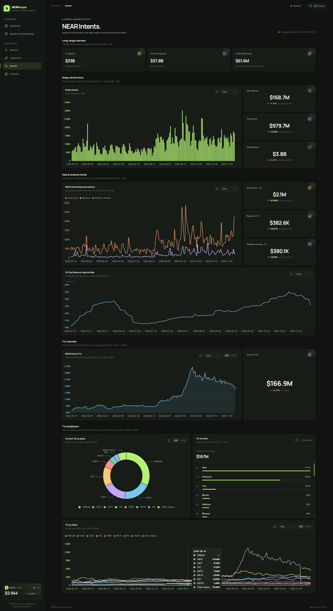

# NEARscope · Beyond Network Growth

NEARscope is a small research project about a question that is easy to skip when looking at activity charts: is NEAR's ecosystem growth creating durable economic value, and how much of that value reaches the network and its token holders?

The dashboard puts network usage, app and Intents economics, supply changes, fee burns, staking, and buyback-wallet flows side by side. It keeps reported activity separate from calculated metrics and from evidence of actual token purchases.

## What is in the repository

```text
data/
  raw/             Saved provider responses and resumable request state
  normalized/      Validated, standardized source records
  analytics/       Dashboard-ready metrics, snapshots, and period series
dashboard/
  app/             Nuxt pages, components, charts, and styles
  public/data/     Local copy of Analytics JSON served by Nuxt
scripts/
  collectors/      BigQuery and FastNEAR collection code
  normalization/  Parsers and normalized-data registry
  analytics/       Domain calculations and JSON output builders
  queries/         BigQuery SQL
  rpc_clients/     Reusable NEAR JSON-RPC client
docs/
  analytics/       Dataset and metric notes
  architecture.md Pipeline structure and ownership boundaries
tests/             Python unittest suite
```

The pipeline is deliberately split into four steps:

```text
providers → raw → normalized → analytics → dashboard
```

Collectors save source responses. Parsers validate and normalize them. Analytics owns joins, formulas, and period aggregation. The Vue dashboard reads those prepared outputs and formats them for display; it does not calculate tokenomics or period totals. A missing or failed source should leave its section empty or on its last saved data while the other sections continue.

Raw, normalized, Analytics, and dashboard public-data JSON files are local working data and are ignored by Git. A fresh checkout therefore needs a fetch before it can show this project's generated research results.

## Requirements

- Python 3.11 or later
- Node.js and npm for the Nuxt dashboard
- Google Cloud CLI (`gcloud`) and Google Application Default Credentials if you want to collect the BigQuery sources
- A Google Cloud project with the BigQuery API enabled for programmatic query jobs

`google-cloud-bigquery` and `near-jsonrpc-client` are Python dependencies in `requirements.txt`; installing that file installs the BigQuery client used by the collectors. BigQuery is a hosted service, so there is no local BigQuery server to install.

## Set up the data pipeline

Create a virtual environment from the repository root.

**Windows PowerShell**

```powershell
py -m venv .venv
.\.venv\Scripts\Activate.ps1
py -m pip install -r requirements.txt
```

**macOS / Linux**

```bash
python3 -m venv .venv
source .venv/bin/activate
python -m pip install -r requirements.txt
```

### BigQuery access

The NEAR queries read Google's public NEAR mainnet tables, but query jobs run under your Google Cloud project. Install the [Google Cloud CLI](https://cloud.google.com/sdk/docs/install), sign in, and create local Application Default Credentials:

```powershell
gcloud init
gcloud auth application-default login
```

The same commands work in macOS and Linux shells. Enable the BigQuery API for the project. If the client cannot infer the project from your ADC configuration, set `GOOGLE_CLOUD_PROJECT` in the shell before running the pipeline:

```powershell
$env:GOOGLE_CLOUD_PROJECT = "your-google-cloud-project"
```

```bash
export GOOGLE_CLOUD_PROJECT="your-google-cloud-project"
```

With on-demand pricing, BigQuery currently includes 1 TiB of query processing per month; bytes above that allowance may be billed to the project that runs the query. Some collectors also set a maximum-bytes-billed guard; a query that exceeds its configured cap fails without returning data. Check the estimate and your project's billing settings before increasing a cap. See [BigQuery public datasets](https://cloud.google.com/bigquery/public-data) and [BigQuery pricing](https://cloud.google.com/bigquery/pricing).

### NearBlocks API key

The NearBlocks endpoints work without a key at the project's conservative request rate. If you need more request allowance, create an API key through NearBlocks and add it to a root `.env` file (or set it in the environment):

```dotenv
NEARBLOCKS_API_KEY=your-key-here
```

The collector sends it as `Authorization: Bearer …`. Available quotas depend on the current NearBlocks plan; check the [NearBlocks API documentation](https://api.nearblocks.io/api-docs/) for current authentication and plan details. Keep the key in the repository-root `.env`, which is ignored by Git. Do not put it in the dashboard's `NUXT_PUBLIC_*` environment variables or commit it.

### Fetch and build datasets

From the repository root, run the complete pipeline:

```powershell
py scripts/main.py
```

On macOS and Linux, use:

```bash
python3 scripts/main.py
```

It runs Fetch, Normalize, then Analytics. Individual source failures are reported, but the pipeline continues with available data. The historical active-validator-stake collector runs at the end of Fetch because it reads block heights from raw `daily_supply.json`. On a first empty checkpoint it starts three calendar months before the current UTC date; later runs continue after the latest saved date.

To rebuild local stages without fetching from providers, run these from the repository root:

```powershell
py scripts/normalize.py        # rebuild normalized files from raw JSON
py scripts/build_analytics.py  # rebuild Analytics from normalized files, then sync the dashboard data
```

On macOS and Linux, replace `py` with `python3`.

Incremental collectors append from the latest raw date instead of starting over. `data/raw/request_state.json` records when each provider was last requested and whether it succeeded; successful requests have a cooldown (24 hours for daily sources, one hour for snapshot sources), while failed requests can be retried. BigQuery and historical RPC collectors request completed UTC dates. Some full-history provider APIs can return a current-day observation; the dashboard keeps the source's own latest date visible instead of assuming every dataset ends on the same day. The contract-reward audit is a fixed-range query; its configured range is 2026-01-01 through 2026-10-04. The current local raw audit file also records an experimental extension through 2026-11-13; Analytics applies the project's protocol-v87 zero-reward policy from 2026-11-05.

The full historical stake bootstrap can take several minutes. The collector shows progress and saves successful daily results as it goes, so rerunning the command resumes from its saved data.

## Run the dashboard

From the dashboard directory:

```powershell
cd dashboard
npm install
npm run dev
```

Open the local URL printed by Nuxt. Do not open an HTML file with `file://`; the app needs to be served so it can load Analytics JSON over HTTP.

`npm run dev`, `npm run build`, and `npm run generate` synchronize `data/analytics/` into `dashboard/public/data/analytics/` before running. `py scripts/build_analytics.py` also performs a sync after building the Analytics outputs. For a manual sync, run this from `dashboard/`:

```powershell
npm run sync:data
```

The dashboard reads its Analytics base path from `NUXT_PUBLIC_ANALYTICS_BASE_URL`. The default is `/data/analytics`. To change it locally, copy `dashboard/.env.example` to `dashboard/.env` and edit the value there.

## Dashboard pages

- **Dashboard** is the short Investment Thesis view: core indicators, economic activity versus supply expansion, buyback-wallet flows, network security, liquidity, and market/supply context.
- **Research & Methodology** states the research question, explains the metrics and their limits, shows findings from the generated snapshots, and records the balanced conclusion.
- **Network**, **Tokenomics**, **Intents**, and **Protocols** hold the detailed charts and tables behind the overview.

## Screenshots

The screenshots below show the Overview and the detailed analytics pages. They are included as visual examples; live values and date ranges change as the local datasets are refreshed.

### Overview


### Network analytics


### NEAR Intents analytics



### Protocol analytics


## How to read the main metrics

These definitions describe what this project computes; they are not interchangeable measures of value:

- **Net issuance** is the difference between consecutive daily total-supply observations: `total_supply(D) - total_supply(D-1)`.
- **Net fee burn** is reported `execution_outcomes.tokens_burnt` minus separately measured contract rewards. The project does not estimate `tokens_burnt` as `gas_burnt × gas_price`; the source field may differ from that product and includes other burn components.
- **Estimated gross issuance** is `net issuance + net fee burn`. It is a supply-reconciliation estimate, not a direct read of validator rewards.
- **Annualized net inflation · 30D** compounds the observed supply change over 30 days: `((supply(D) / supply(D-30))^(365/30) - 1) × 100`. It includes burns through the net supply change.
- **Burn Coverage** is the sum of net fee burn divided by the sum of estimated gross issuance for the selected calendar period. Period totals are built in Analytics; the dashboard does not aggregate daily values.
- **NEAR Intents revenue capture · 30D** is the trailing 30-day sum of reported Intents revenue divided by the sum of gross fees over the same dates. It is a provider-series comparison, not a direct holder yield, and can be affected by revenue-sweep timing.
- **Staking ratio · circulating supply** uses current NearBlocks active stake divided by the latest available circulating-supply observation. Those two source dates can differ. The historical staking chart uses a separate active-stake / total-supply ratio for each date.
- **Top 10 stake share** is the ten largest active validators' combined stake divided by total active stake. It does not tell us whether those validators have independent owners or operators.
- **Buyback-wallet inflows** are transfers into `buybacks.multisignature.near`. They do not verify a market purchase. The wallet's liquid balance is a separate finalized RPC snapshot, not a sum of historical inflows.

Supply observations use approximate FLOAT64 precision. Historical stake totals are summed from YoctoNEAR using arbitrary-precision integers before conversion. Period supply and stake series are period-end snapshots; flow series (fees, burns, issuance, buyback inflows) are summed within the calendar period and are not cumulative across periods. Full formulas, source ranges, current findings, and data-quality notes are on the Research & Methodology page and in `docs/analytics/`.

## Data providers

- **NearBlocks:** network activity, current validator summary, and validator records. The registry is in `scripts/sources.py`.
- **DefiLlama:** NEAR chain TVL and stablecoin supply; NEAR Intents volume, TVL, fees, revenue, and holder revenue; broader NEAR revenue and DEX activity.
- **Google BigQuery public NEAR mainnet:** daily total-supply observations, execution-outcome `tokens_burnt`, contract-reward event audit, and transfers into the buyback multisig. SQL lives in `scripts/queries/`.
- **Binance:** daily NEARUSDT close, used as the project's USD price proxy.
- **FastNEAR archival RPC:** sampled historical active-validator stake and the finalized buyback-wallet balance.

Source endpoints and frequencies live in `scripts/sources.py`. BigQuery collection is in `scripts/collectors/bigquery.py`; FastNEAR collection is in `scripts/collectors/`; normalization is registered under `scripts/normalization/`; and domain calculations are under `scripts/analytics/`.

## Reproduce and inspect

1. Install the Python dependencies and configure the providers you want to fetch.
2. Run `py scripts/main.py` to update raw data, normalize it, build Analytics, and sync the dashboard's local JSON.
3. Review `data/analytics/dashboard.json` for generated timestamps and methodology metadata. Each domain's `snapshot.json` and `data_quality` fields show its own latest date, coverage, and precision; dates are not necessarily synchronized across sources.
4. Open the dashboard or `Research & Methodology` page and compare the rendered values with the exported JSON and metric formulas above.

The Python unit tests use the standard library:

```powershell
py -m unittest discover -s tests
```

## License

MIT. See [`LICENSE`](LICENSE).
